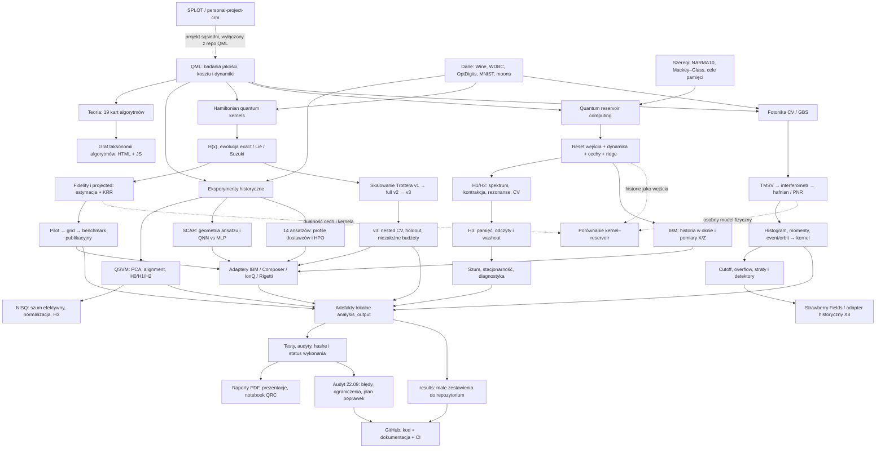
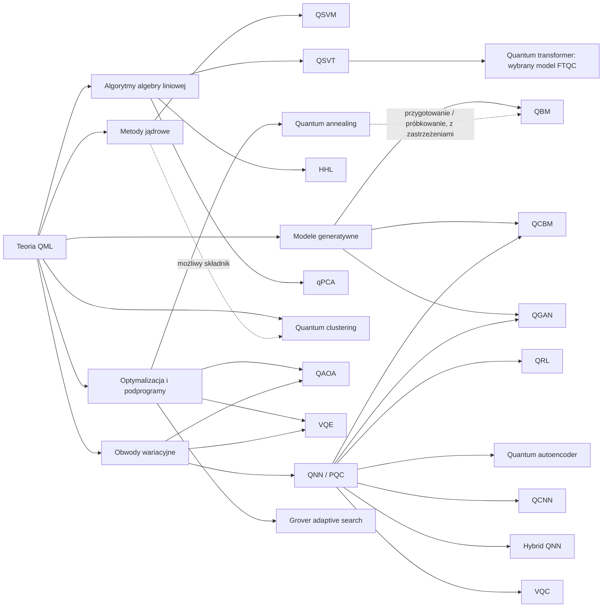

# Mapa całego projektu QML

Strzałki opisują przepływ danych, implementację albo jawnie podpisaną relację
matematyczną. Nie oznaczają potwierdzonej przewagi kwantowej. Stan: 22.09.2026.

## Wszystkie gałęzie teorii

To taksonomia pojęć; HHL, QSVT, VQE i GAS nie są równorzędnymi klasyfikatorami.
QCNN z redukcją rejestru wymaga opisu kanałami. Quanvolution na klasycznych
patchach jest inną architekturą. HHL nie jest wymaganym etapem każdego qPCA.

## Nawigacja po implementacji

| Gałąź | Punkt wejścia | Wyniki / protokół |
|---|---|---|
| QSVM i iteracje | `experiments/legacy/qml_hypothesis_experiment.py`, `qml_iterative_hypothesis_experiment.py`, `qsvm_hypothesis_experiment.py` | historyczne H0/H1/H2; nie mylić z H1/H2 rezerwuarów |
| Efektywny NISQ | `experiments/legacy/qml_nisq_hypothesis_experiment.py` | historyczne H3 i warianty szumu |
| VQE/SCAR | `experiments/legacy/vqe_scar_ansatz_experiment.py` | eksperyment ekspresyjności, bez minimalizacji energii |
| SCAR-QNN | `experiments/legacy/scar_wine_qnn_benchmark.py`, `tools/scar_*` | symulacja, kompilacja, QPU, mitygacja |
| HPO | `experiments/legacy/ansatz_hardware_dataset_benchmark.py`, `tools/*hpo*`, `tools/ibm_composer_hardware_train.py` | 14 adaptacji ansatzów; scenariusze dostawców |
| Hamiltonian kernels | `hamiltonian_kernel/{core,learning,estimation,protocol,publication_benchmark}.py` | `PUBLICATION_BENCHMARK.md` |
| Trotter | `trotter_scaling.py`, `trotter_scaling_full.py`, `trotter_scaling_v3.py` | `TROTTER_SCALING*.md` |
| QRC | `quantum_reservoir/core.py`, `experiment.py`, `spectral_h1_h2_study.py`, `h3_*` | `RESEARCH_PROTOCOL_H1_H5.md`, `H1_H2_SPECTRAL_ANALYSIS.md` |
| Fotoniczne kernele | `photonic_kernel/{core,experiment,robustness}.py` | `README.md`, `ROBUSTNESS.md` |
| Adaptery sprzętu | `hardware_*`, `ibm_hardware.py`, `xanadu_x8.py`, `tools/`, `scripts/` | odróżniać compile, simulator, QPU |
| Materiały końcowe | `tools/build_*`, `tools/generate_*` | lokalne `output/`; ekstrakcja treści w indeksie audytu |
| Weryfikacja | `tests/`, `audits/`, `tools/audit_*` | [raport audytu](audit/README.md) |

Pełny indeks każdego pliku Python i jego deklaracji: [katalog źródeł](audit/source_catalog.md).
Dokładny graf statycznych importów: [source_imports.mmd](source_imports.mmd).
Każdy plik danych i artefakt ma osobny wpis w [inwentarzu](audit/inventory.csv).
