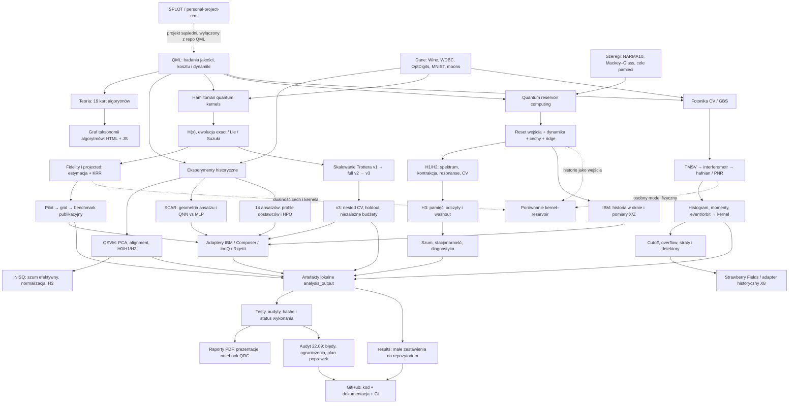
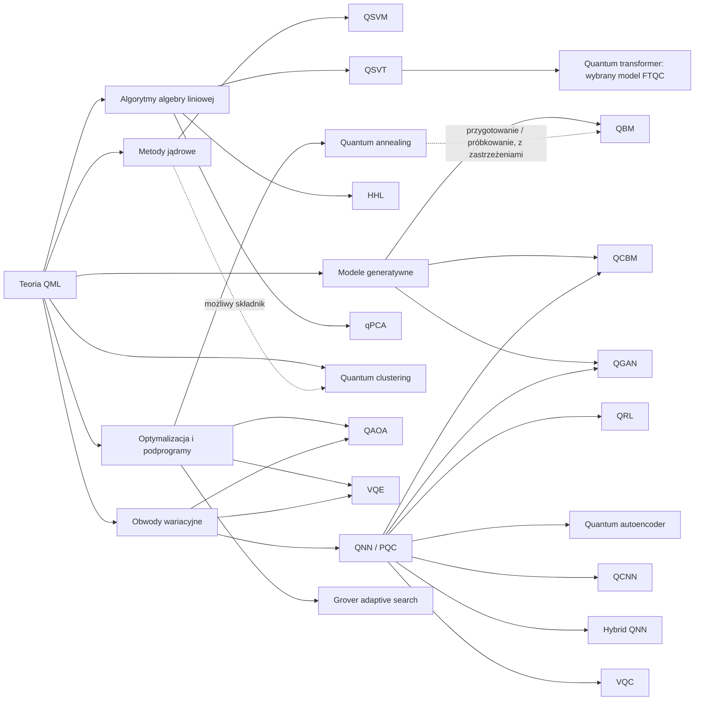

# QML — szczegółowy raport projektu i relacji grafowych

**Wersja raportu: 23 września 2026.** Dokument rozwija audyt z 22 września. Wyniki eksperymentalne są wynikami zastanymi, ponownie odczytanymi podczas opracowania; nie pochodzą z nowych treningów ani nowych uruchomień QPU. Raport można czytać liniowo jako opis pracy badawczej albo używać go wraz z katalogiem relacji do sprawdzania konkretnych połączeń.

## 1. Ocena całości i najważniejsze rozróżnienia

Projekt jest warsztatem badawczym dotyczącym **zamiany danych na cechy przez dynamikę kwantową i oceny użyteczności tych cech przy ograniczonych zasobach**. Nie jest pojedynczym modelem uczenia maszynowego. Łączy atlas teorii, kilka rodzin eksperymentów, implementacje symulatorów, adaptery sprzętowe, analizę statystyczną oraz warstwę dokumentacji. Te części mają różny poziom dojrzałości i różny rodzaj dowodu.

Najbardziej uporządkowaną częścią empiryczną jest benchmark Hamiltonian kernels, w którym rozdzielono selekcję modeli, pomiary i ocenę testową. Najsilniejszą częścią analityczną QRC jest rozróżnienie błędu dynamiki, pamięci, obserwowalności i kosztu odczytu. Fotonika stanowi osobny model fizyczny i wartościowy prototyp estymatorów. Starsze QSVM, SCAR i HPO dokumentują rozwój pomysłów, ale wymagają ostrożniejszego opisu wniosków. Atlas 19 algorytmów porządkuje teorię; jego istnienie nie oznacza implementacji wszystkich 19 rodzin.

W audycie zapisano **18 ustaleń**, od błędów formalnych i metodologicznych po nieścisłości metadanych. Poprawnie działająca macierz, dodatni wynik testu jednostkowego i przekonujący wniosek naukowy są trzema osobnymi osiągnięciami. Zastane 107 testów przeszło lokalnie i w wypakowanej paczce publikacyjnej, ale testy nie obejmowały wszystkich rozpoznanych błędów metodologicznych.

Najważniejsze wyniki wymagają czytania z ograniczeniami:

- Przy budżecie 1 mln circuit-shots historyczna średnia balanced accuracy wynosi około 0,9589 dla projected i 0,8734 dla fidelity. Klasyczny SVM-RBF w tym protokole osiąga około 0,9775. To porównanie konkretnych estymatorów na trzech zbiorach, bez wykazanej przewagi kwantowej.
- Pełny profil Trotter v3 ma zapisane **1 z 1600 warunków** i status `not_confirmatory`. Pozytywny audyt integralności tej części nie zastępuje wykonania pozostałych warunków.
- Protokół QRC H1–H5 jest planem badań. Przegląd spektralny i podbadania H3 dostarczają eksploracyjnych kontroli mechanizmów, lecz nie stanowią zakończonego wykonania całego planu potwierdzającego.
- Wariant fotoniczny threshold z nieidealną sprawnością detektora ma błąd kolejności operacji. Wyników tej ścieżki nie można interpretować jako poprawnej realizacji deklarowanego modelu detekcji przed korektą.

Podstawą dalszej pracy powinien być spójny łańcuch: **pytanie → założenia → implementacja → protokół → obserwacje → wniosek**. Jeżeli brakuje jednego ogniwa, pozostałe mogą nadal być wartościowe, lecz trzeba zawęzić deklarację.

## 2. Zakres dowodów i sposób czytania raportu

Inwentarz wykonany przed reorganizacją obejmował 12 306 plików i 4 627 430 678 bajtów. Aż 12 126 plików należało do `analysis_output`. Dominacja wyników nad kodem jest naturalna w projekcie eksperymentalnym, ale utrudnia ustalenie, która wersja wyniku jest aktualna. Z tego powodu niewielkie, jawnie wybrane zestawienia przeniesiono do `results`, zachowując ich bajty i mapowanie SHA-256 do oryginałów.

Katalog źródłowy audytu obejmuje 112 plików Python, w tym osiem adapterów starych wejść. Analiza AST ustala deklaracje i część statycznych importów. Nie jest dowodem ręcznego przeczytania każdej instrukcji. Przegląd merytoryczny koncentrował się na modelach, estymatorach, podziałach danych, selekcji, kosztach, statusach wyników i tekstach formułujących wnioski. Odczytano treść pięciu PDF-ów i trzech prezentacji; nie przeprowadzono ponownego renderowania i kontroli każdego ich wykresu.

W raporcie obowiązują następujące rozróżnienia:

| Rodzaj stwierdzenia | Co je uzasadnia | Czego samo nie uzasadnia |
|---|---|---|
| Tożsamość lub kontrprzykład matematyczny | jawne rachunki i założenia | jakości konkretnego modelu na nowych danych |
| Zachowanie implementacji | odczyt kodu, test, reprodukcja | zgodności wszystkich historycznych uruchomień z dzisiejszym kodem |
| Wynik historyczny | zachowana tabela, manifest lub raport | nowej niezależnej replikacji |
| Protokół | zadeklarowany plan i zasady selekcji | wykonania planu |
| Audyt integralności | zgodność schematu, hashy i zliczeń | poprawności wszystkich tez naukowych |
| Proponowana poprawka | analiza przyczyny i kryterium akceptacji | jej wdrożenia lub poprawy metryki po wdrożeniu |

Priorytet **P1** oznacza wpływ na interpretację naukową lub możliwość zmiany wyniku. **P2** oznacza potrzebę korekty opisu, metadanych lub zakresu twierdzenia. Priorytet nie jest oceną wartości całej gałęzi. Błąd starszej ścieżki Mackey–Glass nie unieważnia automatycznie nowszego eksperymentu ze skalowaniem wyłącznie na train.

Ocena jest analizą wspomaganą przez AI, a nie zewnętrzną recenzją profesorską. Wcześniejsze równoległe przeglądy zostały przerwane limitem usługi; ustalenia włączone do audytu sprawdzono lokalnie. Nie traktujemy tych przeglądów jako ukończonych, niezależnych opinii ekspertów.

## 3. Anatomia projektu: co znajduje się w każdej warstwie

| Warstwa | Główne zasoby | Odpowiedzialność | Oczekiwany produkt |
|---|---|---|---|
| Teoria | `qml_model_modules`, krytyczna analiza algorytmów | definicje, warunki stosowalności, złożoność i ograniczenia | poprawne, źródłowe opisy metod |
| Atlas relacji | `qml_algorithms_data.js`, `qml_interactive_graph.html`, `qml_relation_metrics.md` | kuratorskie powiązania i podobieństwo opisów | narzędzie nawigacji po pojęciach |
| Eksperymenty historyczne | `experiments/legacy` | QSVM, NISQ, SCAR, QNN i HPO | eksploracyjne porównania i prototypy |
| Kernele Hamiltonowskie | `hamiltonian_kernel` | kodowanie przez H(x), estymacja kerneli, selekcja i benchmark | wyniki predykcyjne i rachunek zasobów |
| Skalowanie Trottera | moduły `trotter_scaling*`, `universal_hamiltonian` | wpływ rzędu, kroku, topologii i ograniczeń | odpowiedź, kiedy przybliżenie jest użyteczne zadaniowo |
| Rezerwuary | `quantum_reservoir` | strumień wejść, pamięć stanu, odczyt i prognoza | profile pamięci, błędy czasowe i analizy kanału |
| Fotonika | `photonic_kernel` | TMSV, interferometr, rozkłady detekcji i cechy | fotoniczne kernele i testy odporności |
| Sprzęt | adaptery w pakietach, `tools`, `scripts` | kompilacja, wysłanie zadania, pobranie i interpretacja zliczeń | obwody, metadane wykonania i wyniki oznaczone właściwym reżimem |
| Kontrola | `tests`, `audits`, manifesty | kontrola kodu, danych i proweniencji | raporty przejścia lub konkretne rozbieżności |
| Komunikacja | generatory raportów, `docs`, lokalne `output` | synteza wyników i ograniczeń | dokumenty bez zmiany znaczenia danych |
| Publikacja | README, konfiguracja pakietu, CI, `results` | odtwarzalny, czytelny zakres GitHuba | repozytorium kodu i dowodów, bez środowisk i zbędnych gigabajtów |

Te warstwy nie są poziomami jakości. Dokument teoretyczny może być poprawny, choć jego algorytm nie ma implementacji. Adapter może poprawnie kompilować obwód, choć nie wykonano go fizycznie. Wynik może być negatywny i nadal stanowić dobry rezultat badawczy.

Drugie workspace zawierało 20 identycznych plików kart i indeksu teorii. Nie tworzy to drugiego zestawu dowodów. Projekt `personal-project-crm` jest zasobem sąsiednim i nie należy do zakresu naukowego QML.

## 4. Wspólny język matematyczny wszystkich gałęzi

### 4.1 Od wejścia do cech

Podstawowy schemat statyczny ma postać `x → ρ(x) → z(x) → ŷ`. Dane x zostają zakodowane w stanie, z którego mierzymy cechy. Dla obserwabli O_j cecha idealna wynosi `z_j(x) = Tr[ρ(x) O_j]`. Wynik finite-shot jest estymatą tej wartości. Nie należy utożsamiać matematycznej funkcji z losowym wynikiem jej pomiaru.

W QRC wejściem jest historia: `u₀,…,uₜ → ρₜ → zₜ → ŷₜ`. Dwie identyczne bieżące wartości u_t mogą dać różne cechy, jeżeli poprzedzały je inne historie. W fotonice pośrednim obiektem jest rozkład `p_x(n)` liczby fotonów albo kliknięć. Histogram i momenty są różnymi, stratnymi opisami tego rozkładu.

Wszystkie gałęzie łączy zatem konstrukcja reprezentacji, ale różnią się **wejściem**, **fizycznym kanałem**, **dostępnym pomiarem** i **odczytem klasycznym**. Równa liczba kubitów nie gwarantuje równej klasy cech, a równa liczba cech nie gwarantuje równego kosztu ich oszacowania.

### 4.2 Dlaczego idealny kernel fidelity jest PSD

Dla stanów czystych `ρ_i = |ψ_i⟩⟨ψ_i|` zachodzi `K_ij = |⟨ψ_i|ψ_j⟩|² = Tr(ρ_iρ_j)`. Dla rzeczywistych współczynników c_i:

```text
Σ_i,j c_i c_j K_ij = Tr[(Σ_i c_i ρ_i)²] ≥ 0.
```

To dowód dodatniej półokreśloności macierzy Grama. Dla zespolonych współczynników stosujemy sprzężenie i kwadrat normy Hilberta–Schmidta. Ten sam kernel `Tr(ρ_iρ_j)` jest PSD dla stanów mieszanych, ale jego diagonala jest wtedy czystością `Tr(ρ_i²)`, niekoniecznie jednością. Nie jest on ogólnie wiernością Uhlmanna.

Każdy element empirycznej macierzy może być oszacowany poprawnie i mimo to cała realizacja finite-shot może mieć ujemną wartość własną. PSD to warunek globalny. Przykładowa symetryczna macierz o diagonalnej 1 i elementach nad przekątną 0,9; 0,9; 0 ma najmniejszą wartość własną `1 − √1,62 < 0`. Sam zakres elementów [0,1] nie wystarcza.

### 4.3 Dlaczego projected i cechy fotoniczne też mogą dawać poprawne kernele

Jeżeli dla wszystkich próbek zbudowano jedną spójną macierz cech Z, to `K = ZZᵀ` jest PSD. RBF `exp(−γ||z−z′||²)` przy γ≥0 także jest poprawnym kernelem. Dotyczy to również jednej zrealizowanej tabeli zaszumionych cech. Nie znaczy to, że każda procedura niezależnego estymowania elementów K zachowa PSD.

Dla rozkładów prawdopodobieństwa Hellinger/Bhattacharyya kernel `K(x,x′)=Σ_n √p_x(n)√p_x′(n)` jest iloczynem skalarnym wektorów pierwiastków. Warunkiem sensownego porównania jest wspólna przestrzeń zdarzeń, w tym zgodna obsługa overflow. Przy porównywaniu histogramów warunkowych i pełnych zmienia się definicja reprezentacji.

### 4.4 Odczyt liniowy i kernel: dokładna relacja, nie identyczność eksperymentów

Ridge minimalizujący `||Zw−y||² + λ||w||²` ma rozwiązanie `w=(ZᵀZ+λI)⁻¹Zᵀy`. Dla `K=ZZᵀ` predykcję można zapisać jako `k_*ᵀ(K+λI)⁻¹y`. To dwie postacie tego samego problemu dla tej samej tabeli cech, tej samej λ oraz zgodnego centrowania i obsługi biasu. Przy celu dzielonym przez N parametr w układzie liniowym jest odpowiednio przeskalowany.

Ta tożsamość wyjaśnia relację kernel–reservoir: odczyt QRC można przedstawić jako metodę jądrową na historiach. Nie czyni ona kernela lokalnych obserwabli równym fidelity między pełnymi stanami. RBF na cechach jest jeszcze innym modelem. Ogólniejsze spojrzenie na modele kwantowe przez metody jądrowe opisuje [Schuld, 2021](https://arxiv.org/abs/2101.11020).

### 4.5 Co zmienia wspólna ewolucja

Dla wspólnego U zachodzi `Tr[(UρU†)(UσU†)] = Tr(ρσ)`. Zastosowanie tej samej unitarności do obu stanów nie zmienia ich iloczynu Hilberta–Schmidta. Hamiltonian kernel jest interesujący dlatego, że U zależy od danych x. W QRC dochodzą reset i różne historie. W projected dodatkowo ogranicza się zbiór obserwabli. Stwierdzenie „dynamika tworzy lepszy kernel” wymaga wskazania, który z tych mechanizmów rzeczywiście zmienia reprezentację.

### 4.6 Cztery błędy, których nie wolno sumować bez definicji

Błąd przybliżenia unitarności, wariancja pomiarów, błąd optymalizacji i błąd generalizacji należą do różnych poziomów. Mniejsza infidelity względem exact może towarzyszyć gorszej klasyfikacji. Więcej shots może zmniejszyć szum estymatora, lecz nie naprawi złego podziału danych. Lepiej rozwiązany problem treningowy może zwiększyć przeuczenie. Raport powinien osobno mierzyć każdy mechanizm i dopiero potem badać zależności między nimi.

## 5. Kernele Hamiltonowskie: od Hamiltonianu do benchmarku

### 5.1 Pytanie badawcze i model fizyczny

Ta gałąź bada, czy ewolucja zależna od x tworzy reprezentację użyteczną predykcyjnie oraz ile kosztuje dostęp do tej reprezentacji. W podstawowym `hamiltonian_kernel/core.py` kodowana część Hamiltonianu ma postać `A(x)=Σ_i x_i Z_i + J Σ_(i,j) Z_iZ_j`, a część poprzeczna `B=gΣ_i X_i`. Topologia określa zbiór krawędzi E: chain, ring albo all-to-all. Stan wejściowy to iloczynowy stan plus. Pełną mapą jest `|ψ(x)⟩=U(x)|+⟩^⊗n`.

Zmiana topologii nie jest wyłącznie zmianą rysunku obwodu. Zmienia sprzężenia w H, a więc reprezentację. Po kompilacji topologia urządzenia dodaje osobne ograniczenie: żądany graf oddziaływań może wymagać routingu i dodatkowych bramek. Nie wolno utożsamiać grafu fizycznego Hamiltonianu z grafem połączeń procesora ani z grafem relacji algorytmów.

### 5.2 Rola modułów

`core.py` odpowiada za model i ewolucję. `learning.py` implementuje cele klasowe ±1, rozwiązanie regularizowanego układu, predykcję przez argmax, metryki i diagnostykę macierzy. To ridge użyte jako klasyfikator, nie standardowy SVM z hinge loss. `experiment.py` i `grid_experiment.py` obsługują wcześniejsze eksploracje. `protocol.py` i `publication_benchmark.py` organizują bardziej kontrolowany eksperyment. `estimation.py` określa, jak finite-shot dane pomiarowe stają się macierzą i cechami. Moduły `hardware_*` realizują oddzielny etap obwodów i wykonania.

Z tego podziału wynika ważna zasada audytu: dobra implementacja `core.py` nie dowodzi poprawności `publication_benchmark.py`, ponieważ błędy selekcji mogą wystąpić poza symulatorem. Analogicznie poprawna cross-validation nie naprawia niezgodnego fizycznie modelu pomiaru.

### 5.3 Fidelity a projected

Fidelity korzysta z porównań par stanów. Dla N próbek pełna macierz wymaga liczby par rzędu N²; koszt obejmuje również test–train i pomiary diagonali zgodnie z protokołem. Obwód overlapu zawiera zwykle przygotowanie jednej mapy i odwrócenie drugiej. Jednego shotu nie wolno więc automatycznie utożsamiać z jednym wykonaniem mapy.

Projected najpierw mierzy lokalne cechy, a podobieństwa oblicza klasycznie. Jedna próbka pomiaru w bazie Z może informować o wielu Z_i jednocześnie. Pomiar w X i Y wymaga innych ustawień. W aktualnym estymatorze wspólne bitstringi zachowują kowariancje obserwabli. Niezależne losowania dwumianowe dla każdej cechy dają inny model wariancji, nawet jeżeli oczekiwania pojedynczych cech się zgadzają.

Projected ogranicza informację do wybranego zestawu obserwabli, ale może efektywniej wykorzystywać pomiary. To sensowny kompromis statystyczny: pełniejsza reprezentacja teoretyczna może być gorzej oszacowana przy tym samym budżecie.

### 5.4 Co dokładnie mierzył benchmark publikacyjny

Zamrożony profil obejmuje `moons`, WDBC i Wine, pięć powtórzeń pięciofoldowej zewnętrznej CV, trójfoldową wewnętrzną CV, pięć realizacji szumu pomiarowego oraz budżety 200 tys. i 1 mln circuit-shots. Każda rodzina ma 12 konfiguracji strojenia. Standardyzacja i PCA są dopasowywane wewnątrz odpowiednich foldów. Klasyczne baseline'y korzystają z tego samego wejścia po PCA(4).

To ostatnie ograniczenie jest istotne: test porównuje modele przy dopasowanym wejściu. Nie jest pełnym konkursem na najlepszy możliwy klasyczny model na oryginalnych danych. Uczciwy raport powinien pokazywać zarówno matched-input, jak i odrębny mocny benchmark klasyczny bez narzuconego ograniczenia do czterech składowych, jeżeli celem jest praktyczna przewaga.

| Rodzina i reżim | Budżet circuit-shots | Średnia BA | SD obserwacji |
|---|---:|---:|---:|
| Fidelity, finite-shot | 200 000 | 0,80526 | 0,09703 |
| Fidelity, finite-shot | 1 000 000 | 0,87336 | 0,07436 |
| Projected, finite-shot | 200 000 | 0,93101 | 0,08359 |
| Projected, finite-shot | 1 000 000 | 0,95892 | 0,04544 |
| Fidelity, ideal statevector | nie dotyczy | 0,97398 | 0,02674 |
| Projected, ideal statevector | nie dotyczy | 0,97385 | 0,02853 |
| SVM-RBF, klasyczny | nie dotyczy | 0,97754 | 0,02554 |
| Random Fourier features | nie dotyczy | 0,97321 | 0,02335 |
| Gradient boosting | nie dotyczy | 0,95273 | 0,03440 |
| Model liniowy | nie dotyczy | 0,93863 | 0,05224 |

Źródło liczb: `results/hamiltonian/publication_summary.csv`. SD jest odchyleniem wyników obserwacji, nie standardowym błędem średniej ani przedziałem ufności. Wiersze finite-shot mają po 375 obserwacji, pozostałe po 75. Wiele obserwacji współdzieli dane, podziały albo dynamikę.

Przy 1 mln circuit-shots przewaga projected nad fidelity wynosi około **8,56 punktu procentowego BA**, natomiast różnica projected względem SVM-RBF wynosi około **−1,86 punktu procentowego**. Są to różnice średnich z tabeli, nie samodzielne wyniki testu istotności. Przy 200 tys. różnica projected–fidelity wynosi około 12,57 punktu procentowego. W danych idealnych obie rodziny kwantowe są bardzo blisko siebie. Całość sugeruje istotną rolę estymacji przy skończonych pomiarach; nie identyfikuje uniwersalnej wyższości reprezentacji projected.

### 5.5 Naprawa PSD i spójność train/cross

Jeżeli mierzymy macierz train, obcięcie ujemnych wartości własnych zmienia geometrię. Cross-kernel musi być interpretowany w tej samej geometrii. Przykładowa konstrukcja na landmarkach ma cechy train `V₊Λ₊^(1/2)` i cechy nowej próbki wyprowadzone z jej overlapów z landmarkami oraz `V₊Λ₊^(−1/2)`, z odpowiednią kontrolą małych wartości własnych. Następnie wszystkie iloczyny skalarne liczy się w jednej przestrzeni cech.

Przy inner CV dopasowanie takiej mapy na całym outer train przed podziałem inner może wykorzystywać geometrię walidacji. Należy z góry ustalić, czy testujemy uczenie indukcyjne, czy transdukcyjne. Zalecana dla tego benchmarku procedura indukcyjna dopasowuje preprocessing, landmarki i transformację widma wyłącznie na aktualnym train.

H-03 dotyczy osobnego zagadnienia: po normalizacji wektorów cech kernel nadal jest PSD, lecz jego widmo nie jest już widmem sprzed normalizacji. Przeskalowanie `D K D` jest kongruencją, nie transformacją podobieństwa. Dlatego nazwa `spectral_eigenvalues` powinna określać etap, zbiór landmarków i normalizację. Reprodukcja audytu wykazała rozbieżność widm około 0,45105. Nie jest to automatycznie błąd predykcji.

### 5.6 Koszty i poprawna interpretacja

Należy osobno raportować: liczbę ustawień obwodów, circuit-shots, wykonania map, 2Q-gate-shots, głębokość, czas QPU i kredyty dostawcy. Koszt `Σ_c S_c G₂Q,c` jest użytecznym proxy ekspozycji na bramki dwukubitowe, lecz nie mierzy całego czasu urządzenia. Klasyczny baseline nie ma „zerowego kosztu obliczeń”; ma brak zastosowania metryki QPU-shots. Exact w symulatorze także nie jest darmowym obwodem sprzętowym.

Historyczna korekta kosztów dla J=0 została już wydzielona i oznaczona manifestem. Należy cytować właściwą wersję kosztów. Nie ma podstaw, aby ponownie zgłaszać ten sam problem jako nowy, nieusunięty błąd wszystkich tabel.

## 6. Trotteryzacja: trzy poziomy pytania badawczego

### 6.1 Przybliżenie dynamiki

Dla `H=A+B` schemat Liego ma przy ustalonym czasie asymptotyczny błąd rzędu `O(t²/r)`, a symetryczny Strang `O(t³/r²)`, ze stałymi zależnymi od norm komutatorów. W projekcie prawy czynnik macierzy działa pierwszy. Warto sprawdzać tę konwencję przy przekładzie wzoru na kolejność bramek.

Gdy `[A,B]=0`, rozkład jest dokładny w arytmetyce idealnej. To kontrola algebraiczna. Gdy części nie komutują, zwiększanie r na ogół poprawia asymptotyczną aproksymację, ale konkretna mała siatka może wykazywać rezonanse i zachowania niemonotoniczne. Wzór asymptotyczny nie daje automatycznie numerycznej gwarancji ze stałą równą jeden.

Uogólniona warstwa `universal_hamiltonian.py` obsługuje sumy Paulich oraz rzędy 1, 2 i 4. Nie należy przypisywać rzędu 4 starszemu `core.py`, którego konfiguracja dopuszcza rzędy 1 i 2. Ujemne podkroki czwartego rzędu są dozwolone przy odwracalnej ewolucji unitarnej; bez osobnego uzasadnienia nie można ich traktować jako ujemnego czasu dowolnego kanału dyssypacyjnego.

### 6.2 Przybliżenie jako inna reprezentacja

Dla uczenia maszynowego Trotter nie jest tylko niedokładnym kalkulatorem U. Zmienia mapę cech i jej efektywne sprzężenia. Model przybliżony może przypadkowo lepiej dopasować się do zadania, działać jak ograniczenie pojemności albo gorzej oszacować istotne cechy. Dlatego trzeba osobno zapytać: czy zachowuje dynamikę, czy zachowuje jakość predykcji i czy zmniejsza koszt.

Dobór `(p,r)` według podobieństwa do exact odpowiada na inne pytanie niż wybór według walidacyjnej BA. W starszym v2 funkcja selekcji mieszała diagnostykę exact z jakością. V3 słusznie oddziela te etapy i traktuje dawne małe p-value jako eksploracyjne.

### 6.3 Co zmienia v3

V3 rozdziela osie głębokości, circuit-shots i 2Q-gate-shots. Zna koszt kandydatów przed odblokowaniem testu. Polityka i regularizacja są wybierane w inner CV. Exact jest obliczane później jako diagnostyka. Siatka kroków 0,01–1,00 dla rzędów 1/2/4 jest rejestrowana, lecz kandydaci przechodzą wstępny filtr kosztowy; nie oznacza to pełnej numerycznej oceny 300 konfiguracji.

Plan obejmuje pięć rozmiarów rejestru, cztery profile Hamiltonianu, cztery topologie, 20 seedów Hamiltonianu i osiem komórek zasobów. 1600 warunków dotyczy kombinacji rozmiaru, profilu, topologii i seeda. Dalsze powtórzenia CV i pomiarów generują do 153 600 ocen outer. Tych poziomów nie wolno nazywać zamiennie liczbą niezależnych eksperymentów.

Zachowany wynik pełnego profilu ma 96 outer rows i jeden ukończony warunek. `development_complete=false`, `holdout_complete=false`, a wnioskowanie czeka na ukończenie pełnego planu. Osobny ukończony smoke potwierdza techniczne przejście ścieżki. Nie jest skróconą, ale równoważną wersją testu potwierdzającego.

### 6.4 Dwie poprawki wymagane przed kolejną wersją

**H-01:** selektor i końcowa predykcja v3 korzystają z raw kernel, podczas gdy naprawione macierze PSD są zapisywane diagnostycznie. Dla nieokreślonego K można rozwiązać `(K+λI)α=y`, ale nie jest to automatycznie standardowe wypukłe KRR w RKHS. Należy wybrać i zadeklarować metodę, a następnie zapisać faktyczny etap macierzy użytej do predykcji. Sama etykieta `PSD` w katalogu wyników nie wystarcza.

**H-02:** rezerwacja kosztu testu wykorzystuje najdroższego kandydata, a zapis nazywa ją faktycznym zużyciem. W sprawdzonym przykładzie raportuje 9928 zamiast 5032 gate-shots po wyborze tańszej polityki. Rezerwacja jest bezpieczna budżetowo; błędna jest interpretacja zużycia. Należy rozdzielić `reserved` i `used`.

Zmiana tych elementów wymaga nowego protokołu i katalogu wyników. Nie należy dopisywać nowych realizacji zmienionego estymatora do zamrożonego runu pod starym hashem.

## 7. Rezerwuary kwantowe: pamięć, obserwowalność i przyczynowość

### 7.1 Mechanizm obliczeniowy

Rezerwuar ma ustaloną dynamikę, a uczony jest przede wszystkim klasyczny odczyt. W modelu projektu kubit wejściowy jest zastępowany stanem `|ψ(u)⟩=√(1−u)|0⟩+√u|1⟩`. Reset ma postać `R_u(ρ)=|ψ(u)⟩⟨ψ(u)|⊗Tr₀ρ`. Następnie `ρ_t=U R_(u_t)(ρ_(t−1)) U†`. To kanał całkowicie dodatni, zachowujący ślad. Pamięć wejść pozostaje w pozostałych kubitach i korelacjach odbudowywanych przez dynamikę.

Korzenie tej architektury opisuje [Fujii i Nakajima](https://arxiv.org/abs/1602.08159). W tym projekcie przedmiotem badań jest głównie wpływ dyskretyzacji i odczytu na dostępną pamięć, a nie trenowanie całego obwodu jako VQA.

### 7.2 Cztery różne widma

Widmo H mówi o energiach. Widmo U zawiera fazy zależne od energii modulo okres próbkowania. Widmo kanału `Ad_U∘R_u` opisuje ewolucję operatorów dla ustalonego wejścia. Odczyt z wybranych obserwabli ujawnia tylko część modów tej ewolucji. Dwa mody o różnej energii mogą po próbkowaniu mieć tę samą fazę; mod długo żyjący może być prawie niewidoczny w mierzonych cechach.

Słowo „ciągły” także ma kilka znaczeń. CV oznacza model zmiennych ciągłych, lecz oscylator harmoniczny ma dyskretne energie. Ciągły czas nie oznacza ciągłego widma. Skończone obcięcie Focka zawsze daje macierz skończoną i samo nie rozstrzyga własności operatora nieskończenie wymiarowego.

### 7.3 Reset nie jest automatycznym dowodem ESP

Dwa stany różniące się ortogonalnym stanem części niepodlegającej resetowi pozostają doskonale rozróżnialne po pojedynczym resecie. Wspólna unitarność nie zmniejsza ich odległości śladowej. Jednokrokowy współczynnik kontrakcji całego stanu może więc wynosić 1; kontrola numeryczna projektu właśnie to potwierdza.

Jeżeli dopiero blok L kroków ma jednolicie współczynnik q<1 dla wszystkich dozwolonych sekwencji wejść, można ograniczyć narastanie błędu przybliżenia przez wyrażenie typu `q^k D₀ + Lε(1−q^k)/(1−q)`. Słowo „jeżeli” jest zasadnicze. Widmo jednego kanału przy zamrożonym u=0,5 nie dowodzi tej własności dla przełączanego układu. Skończona próba washout także jej nie dowodzi dla wszystkich wejść i stanów.

Im q bliższe jedności, tym większy może być współczynnik błędu stacjonarnego. Długa pamięć bywa korzystna dla zadania i równocześnie zwiększa wrażliwość na perturbacje. To relacja wymagająca jednoczesnego pomiaru pamięci i jakości, a nie prostego maksymalizowania czasu zaniku.

### 7.4 Zadania i błędy starszej ścieżki

NARMA10 jest zadaniem identyfikacji wymuszanego układu nieliniowego. Mackey–Glass h=5 oznacza prognozowanie wartości pięć kroków naprzód z informacji dostępnej w chwili t. To nie jest autonomiczny rollout modelu na własnych predykcjach. Wynik zależy także od dyskretyzacji generatora.

**R-01:** starszy generator MG oblicza min/max po całym szeregu. Informacja o przyszłym ogonie wpływa wtedy na kodowanie danych treningowych. Poprawka polega na zwracaniu surowej serii oraz dopasowaniu skalera wyłącznie na train. Test przyczynowości powinien zmieniać przyszły ogon i sprawdzać, że wejścia treningowe pozostają identyczne. Wielkości wpływu tego błędu na historyczne NRMSE nie oszacowano nowym pełnym uruchomieniem.

**R-02:** przy celu x_(t+5) rozłączne indeksy wejść train i validation nie wystarczają. Ostatnie etykiety train mogą pochodzić z okresu validation. Przy zamrożeniu modelu na granicy czasu takie etykiety nie były jeszcze dostępne. Potrzebna jest kontrola timestampów targetu i pięciokrokowy gap. Kontynuowanie stanu rezerwuaru na znanych wejściach przez granicę segmentów nie jest samo w sobie błędem.

Nowsze podbadanie spektralne stosuje train 200–799, validation 805–1054 i test 1060–1359. Pierwotny plan H1–H5 przewiduje dłuższe segmenty: train 200–1199, validation 1205–1604 i test 1610–2009. To dwa różne protokoły; nie należy utożsamiać spektralnej próby eksploracyjnej z realizacją pełnego planu.

### 7.5 Co mierzy pamięć

Dla opóźnienia d odczyt rekonstruuje dawny sygnał v_(t−d). Wskaźnik `C(d)=1−SSE/SST` jest oceną konkretnego dekodera na teście. Może być ujemny. Suma po 20 opóźnieniach to wynik dla wybranej rodziny celów i skończonej próby, nie pojemność całej przestrzeni Hilberta.

Cele iloczynowe i kwadratowe badają inne funkcje historii niż cele liniowe. Różnica `T=średnia(C_NL)−średnia(C_L)` może wzrosnąć, gdy pamięć liniowa spada, nawet jeśli nieliniowa również spada. Dodatnie ΔT nie jest samo w sobie poprawą obliczeń nieliniowych. Trzeba pokazywać oba profile.

Pełniejszy readout, np. 255 nieidentycznościowych oczekiwań Paulich dla czterech kubitów, jest diagnostycznie użyteczny, ale nie jest tanim odpowiednikiem kilku ustawień pomiarowych. Więcej cech może także pogorszyć generalizację przy skończonej próbie i stałej regularizacji. Zwiększenie ilości informacji dostępnej teoretycznie nie zapewnia jej stabilnego wykorzystania przez estymator.

### 7.6 Dokładne znaczenie H1–H5

| Hipoteza | Co ma wykazać plan | Główne warunki sukcesu | Czego nie wolno wnioskować |
|---|---|---|---|
| QRC/H1 | zachowanie jakości przy tańszym schemacie p=2,r=2 | iloraz błędów <1,02 względem exact i redukcja kosztu ≥25% względem r=16 | brak istotnej różnicy nie dowodzi non-inferiority |
| QRC/H2 | poprawę predykcji przez walidacyjny wybór dynamiki | testowy geometryczny iloraz NRMSE <0,98 | niewielka poprawa poniżej 2% nie spełnia tej hipotezy |
| QRC/H3 | zmianę profilu pamięci dla p=1,r=1 | niezerowe ΔT w zadeklarowanym teście dwustronnym | zmiana nie musi być korzystna ani powodować poprawy NRMSE |
| QRC/H4 | zależność względnej użyteczności schematu od budżetu | interakcję kontrastu jakości z dwoma budżetami 2Q-gate-shots | nie jest to izolowany efekt shots przy stałej głębokości |
| QRC/H5 | oszczędność przez wspólny wybór schematu i okna W | jakość <1,02 i koszt wdrożenia <0,75 odniesienia | oszczędność inferencji nie oznacza oszczędności całego wyszukiwania |

Progi 2% i 25% są kryteriami zadeklarowanego planu, nie uniwersalnymi stałymi teorii QRC. Główna próba miała obejmować 20 bloków; liczebność jest budżetem badania, a nie gwarancją mocy testu. H4–H5 są rozszerzeniem zasobowym. Raport ukończenia musi osobno oznaczać wykonane hipotezy i niewykonane etapy.

### 7.7 Szum i sprzęt

Szum może przyspieszać zapominanie niepożądanego stanu początkowego i jednocześnie usuwać informację o sygnale. W modelach relaksacji i dekoherencji trzeba zachować fizyczne ograniczenia, w tym odpowiednią relację T₂≤2T₁. Syntetyczny kanał nie staje się kalibracją urządzenia przez nadanie mu nazwy dostawcy.

Na QPU trzeba odtwarzać historię, aby wielokrotnie mierzyć stan końcowy. Pomiar destrukcyjny nie daje bezkosztowego dostępu do całej trajektorii w wielu bazach. Okno W oszczędza zasoby, lecz zmienia stan względem pełnej historii. Koszt rewind, resetów, ustawień X/Z i shots należy liczyć łącznie. Audyt adaptera zgodności kolejności kubitów jest potrzebny, ale nie zastępuje porównania błędu full–window.

## 8. Fotonika: inny model fizyczny, wspólne pytanie o reprezentację

### 8.1 Konstrukcja modelu

W `photonic_kernel/core.py` model ma osiem modów i cztery pary stanów dwumodowo ściśniętych TMSV. Interferometr miesza mody, a dane wpływają na konfigurację faz. Macierz opisująca czysty stan gaussowski jest przekształcana zgodnie z `B=W B₀ Wᵀ`. Transpozycja w tym wzorze jest istotna i nie może być dowolnie zastąpiona sprzężeniem hermitowskim. Rozkład PNR korzysta z hafnianów odpowiednich podmacierzy.

To nie jest ten sam obiekt co kilkukubitowy statevector. Jeden mod optyczny ma nieskończenie wiele poziomów obsadzenia. Osiem modów nie oznacza ośmiu kubitów. Obcięcie liczby fotonów jest przybliżeniem przestrzeni Focka, którego błąd trzeba kontrolować. Mały enumerator w projekcie służy weryfikacji modelu; wykładniczy koszt klasycznego obliczania rozkładu nie jest dowodem, że zadanie klasyfikacyjne z tego rozkładu daje przewagę.

### 8.2 Trzy poziomy reprezentacji

Pierwszym poziomem jest pełny rozkład zliczeń. Drugim — jego estymata histogramowa lub agregacja event/orbit. Trzecim — wybrane momenty i ich kernel. Przejście między poziomami traci informację. Na przykład orbit features grupują wzorce według obsadzeń, ograniczając wrażliwość na konkretne przypisanie modów; to może być przydatna niezmienniczość albo utrata sygnału zależnie od zadania.

Hellinger kernel porównuje histogramy, a moment RBF porównuje klasyczne wektory statystyk. Oba mogą być PSD. Ani dodatnia półokreśloność, ani pochodzenie cech z optyki nie dowodzą, że etykiety klas są dobrze rozdzielone w tej reprezentacji.

### 8.3 Cutoff i overflow

Jeżeli zachowujemy tylko zdarzenia poniżej cutoff i dzielimy przez liczbę zaakceptowanych próbek, uczymy się na rozkładzie warunkowym. Dwie próbki o bardzo różnych prawdopodobieństwach akceptacji mogą wtedy otrzymać podobne histogramy. Jawny bin overflow i normalizacja przez wszystkie raw shots zachowują dodatkową informację o masie poza oknem.

Sama masa overflow nie opisuje jednak, ile fotonów zawierały pominięte zdarzenia. Po stratach część z nich może wejść do obserwowanego okna. Bez rozkładu ogona nie można dokładnie odtworzyć tego przejścia. Ilościowe badanie strat powinno korzystać z odpowiednio kontrolowanego surowego PNR albo symulować straty przed detekcją i obcięciem.

**P-02** dotyczy komunikacji tej zmiany: README zawiera zarówno aktualną uwagę o overflow, jak i starszy opis histogramów warunkowych. Należy nadać wersję schematowi cech i jednoznacznie przypisać do niego tabele. Zmiana definicji cech bez zmiany opisu może być ważniejsza interpretacyjnie niż niewielka zmiana BA.

### 8.4 Detektor PNR i threshold

PNR rozróżnia liczby fotonów. Threshold rozróżnia jedynie brak kliknięcia i kliknięcie. Dla n fotonów i niezależnej sprawności η prawdopodobieństwo co najmniej jednej detekcji wynosi `1−(1−η)^n`. Zjawisko to zachodzi przed utratą informacji o n.

**P-01:** w ścieżce Strawberry Fields wykonywano threshold, a następnie losowo usuwano otrzymany bit ze sprawnością η. Dla n=2, η=0,5 daje to 0,5 zamiast 0,75. Model nie jest równoważny stratnej detekcji fotonów. Nie dotyczy to automatycznie funkcji thinning stosowanej do rzeczywistych surowych zliczeń PNR.

Naprawa powinna albo zastosować `LossChannel(T·η)` przed natywnym threshold i nie liczyć ponownie tych strat, albo pobrać PNR i wykonać kolejno thinning oraz progowanie. Dark counts wymagają osobnego modelu, np. dodatkowego kliknięcia z prawdopodobieństwem `1−exp(−μ)` przy poissonowskim tle. Znaczenie natywnego pomiaru opisuje [dokumentacja Strawberry Fields](https://strawberryfields.readthedocs.io/en/latest/code/api/strawberryfields.ops.MeasureThreshold.html).

### 8.5 Status wyników i połączenie z QRC

Zachowany audyt X8 ma 10/10 kontroli, a pilot obejmował 18 obwodów i 12 000 shots. To zapis lokalnego pilota i jego kontroli, nie dowód wykonania na fotonicznym QPU. Bieżące środowisko podstawowe nie zawiera zweryfikowanego historycznego runtime Strawberry Fields. Adapter i manifest endpointu należy rozróżniać od zwróconych fizycznych zliczeń.

Związek fotoniki z QRC polega na wspólnym wykorzystaniu fizycznej mapy do cech. Aktualny kernel fotoniczny nie staje się rezerwuarem czasowym wyłącznie dlatego, że interferometr nazwano reservoir. Aby mówić o QRC, trzeba określić sekwencyjne wejścia, stan zależny od historii i mechanizm pamięci. Związek w grafie jest porównawczy, nie dowodem identyczności modeli.

## 9. Starsze eksperymenty: QSVM, NISQ, SCAR i HPO

### 9.1 Geneza i osiem modułów

Historyczna gałąź przechodzi od wyboru mapy cech i liczby kubitów do modeli szumu, ansatzów i prób sprzętowych. Źródła znajdują się teraz w `experiments/legacy`; osiem plików w `analysis_output` zachowuje stare wejścia. Przeniesienie zmieniło ROOT i importy, nie algorytmy badawcze. Manifest migracji dokumentuje tę operację.

| Moduł | Rzeczywiste zadanie | Główna uwaga interpretacyjna |
|---|---|---|
| `qsvm_hypothesis_experiment` | eksploracja map, PCA i klasyfikacji jądrowej | wariant wieloklasowy jest ridge na targetach, nie standardowym hinge-loss SVM |
| `qml_hypothesis_experiment` | binarna klasyfikacja LS-SVM z biasem i selekcją mapy | preprocessing, finalny refit i definicja alignmentu wymagają jawnego opisu |
| `qml_iterative_hypothesis_experiment` | wybór konfiguracji bliskiej najlepszemu alignmentowi | próg 95% nie oznacza ścisłego maksimum |
| `qml_nisq_hypothesis_experiment` | wrażliwość na efektywne tłumienie i pomiary | uproszczony profil nie jest pełnym kanałem urządzenia |
| `vqe_scar_ansatz_experiment` | ekspresyjność i splątanie ansatzu | bez minimalizacji energii nie jest wynikiem VQE |
| `scar_wine_qnn_benchmark` | QNN i klasyczna głowica wobec MLP | równa liczba parametrów nie wyrównuje kosztu treningu |
| `ansatz_hardware_dataset_benchmark` | 14 adaptacji ansatzów i HPO | selekcja wewnątrz przypadku i wybór przypadku do QPU są osobnymi etapami |
| `generate_scar_circuit_visualization_png` | wizualizacja konstrukcji obwodu | rysunek nie zastępuje kompilacji i rachunku zasobów |

### 9.2 Alignment i błąd twierdzenia H2

Alignment jest znormalizowanym iloczynem Frobeniusa macierzy kernela i kernela etykiet, często po centrowaniu. Mierzy zgodność geometrii z etykietami na określonej próbie. Jego zwiększanie na train nie jest gwarancją lepszej generalizacji. Użycie etykiet do selekcji jest uczeniem i musi mieścić się w granicach train/validation.

Reguła historyczna wybiera kandydatów o alignment co najmniej 95% maksimum siatki, po czym stosuje kryteria prostoty. **L-02:** opis jako ścisłego argmax jest za mocny. Także „podobne normy” macierzy nie pozwalają zastąpić maksymalizacji ilorazu maksymalizacją samego licznika; potrzebna jest stała norma lub jawna normalizacja.

**L-01:** z warunku q≥4 nie wynika czterokrotne zmniejszenie wymiaru w porównaniu z sześcioma kubitami. Dla q=4 stosunek wynosi 16/64=1/4; dla q=6 wynosi 1; dla q=8 wynosi 4. Poprawiona teza musi zawierać warunek **wybrano q*=4**. Nawet wtedy jest to porównanie wymiarów statevector, nie automatycznie czasu sprzętu, shots lub całego treningu.

Monotoniczność błędu rekonstrukcji PCA `E_q=Σ_(k>q) λ_k` dotyczy rekonstrukcji danych w ustalonej metryce. Nie mówi, że każda dodatkowa składowa jest informatywna o klasie ani że mniejszy q jest zawsze lepszy. H2 powstało po analizie wcześniejszych wyników; należy oznaczać tę genezę jako iterację eksploracyjną.

### 9.3 SCAR: co potwierdzono, a czego nie

Macierz bramki SCAR jest unitarna w sprawdzonym przypadku z błędem około 8,8×10⁻¹⁷. Jej struktura obejmuje wymianę XX+YY, fazę chiralną i ZZ. Ten rachunek wspiera poprawność podstawowego obiektu. Nie ustala jednak nowości rodziny względem fSim, XY, ZZ i lokalnych rotacji.

Deskryptor ekspresyjności oparty na rozkładzie overlapów i KL względem Haar mierzy konkretny aspekt losowo próbkowanych stanów. Meyer–Wallach mierzy uśrednione jednocząstkowe splątanie stanów czystych. Żaden z nich osobno nie dowodzi uniwersalności ansatzu, łatwości optymalizacji ani przewagi predykcyjnej. Zbyt duża ekspresyjność również może być problemem treningowym.

Plik nazwany VQE nie zawiera ukończonego eksperymentu minimalizacji energii. Aby taki wynik uzyskać, trzeba określić Hamiltonian celu, stan referencyjny, pomiary energii, optymalizator, budżet i odniesienie do energii dokładnej lub mocnego klasycznego przybliżenia. Obecne deskryptory są etapem przygotowania ansatzu.

### 9.4 Profile dostawców i wybór do QPU

W HPO stosowano skalarny współczynnik tłumienia zależny od liczby bramek i profilu. Trening i walidacja korzystały z analitycznych cech przy `shots=0`; szum pomiarowy pojawiał się w teście. **L-05:** właściwa nazwa to „analityczny trening na tłumionych cechach, finite-shot inference”. Nie jest to równoważne uczeniu z szumem gradientów i pomiarów na QPU.

**L-03:** wewnętrzne HPO w danym przypadku wybiera po validation, ale `run_best_hpo_ibm_qpu.py` wybiera przypadek do pilota po testowej BA. Test uczestniczy więc w selekcji wybranego zwycięzcy. Wynik tego przypadku można opisać jako pilot po selekcji eksploracyjnej, nie niezależne potwierdzenie jakości „najlepszego modelu”. Kolejna ocena wymaga nowego holdoutu.

W jednym z opisanych pilotów 15 próbek testowych oznacza, że pojedyncza pomyłka zmienia accuracy o około 6,67 punktu procentowego. Rankingi z trzema miejscami po przecinku ukrywają tę rozdzielczość. Potrzebna jest niepewność i opis doboru próbek.

### 9.5 Co mówi zapisany pilot SCAR na IBM

Historyczny raport `ibm_fez` podaje accuracy około 0,400 dla badanego QNN wobec 0,971 MLP, 66 CZ po routingu oraz 12 epok SPSA. Idealny QNN trenowano dłużej, przez 160 epok. To nie jest kontrola izolująca sam szum: zmieniły się również budżet i procedura treningu.

Moduły architektury Rigetti/IonQ, symulowane reprodukcje i analizy mitygacji dotyczą różnych reżimów. Nazwa pliku zawierająca `physical` nie jest dowodem fizycznego wykonania. Korekcja macierzy odczytu wymaga osobnych kalibracji i uwzględnienia ich wariancji; nie odwraca ogólnie błędów bramek.

## 10. Atlas teorii: osobna ocena wszystkich 19 kart

Atlas graficzny zawiera **20 węzłów**, ponieważ oprócz 19 szczegółowych kart ma kategorię nadrzędną Quantum Kernel Methods. Liczba węzłów nie jest liczbą wdrożonych algorytmów. Poniższe opisy rozdzielają przedmiot karty, jej relację z innymi metodami i wymagane doprecyzowanie.

### 10.1 QSVM

Karta opisuje SVM wykorzystujące kernel estymowany z obwodu. Kwantowy jest mechanizm cech lub pomiaru podobieństwa; klasyczny solver nadal może rozwiązywać standardowy problem SVM. Osobną rodziną są algorytmy FTQC dla układów liniowych LS-SVM. Stąd QSVM→quantum kernels jest silną relacją definicyjną dla wariantu kernelowego, a QSVM→HHL dotyczy tylko wybranych konstrukcji FTQC. Projekt historyczny dodatkowo zawiera ridge i LS-SVM, które trzeba nazwać precyzyjnie.

### 10.2 VQC

VQC jest klasyfikatorem z parametryzowanym obwodem i odczytem Bornowskim. Dla prawdopodobieństw klas potrzebny jest pomiar o elementach sumujących się do I. Parametr shift ±π/2 ze współczynnikiem 1/2 jest poprawny dla bramki `exp(−iθP/2)` z P²=I. **T-05:** dla generatora o wartościach ±r przesunięcie wynosi π/(4r), a prefaktor r. Uogólnienie tej reguły bez skali generatora jest błędne.

### 10.3 QNN / PQC

PQC jest obwodem parametryzowanym; QNN oznacza rodzinę modeli uczenia wykorzystujących takie obwody i pomiary. Pojęcia silnie się pokrywają, lecz nie są identyczne. Wartość oczekiwana obserwabli definiuje funkcję deterministyczną, zaś jej pomiar jest losowy. Relacje do VQC, QCBM, QCNN i autoenkodera wyrażają współdzielenie konstrukcji, nie identyczną funkcję celu.

### 10.4 Hybrid QNN

Model hybrydowy łączy klasyczny encoder, warstwę kwantową i klasyczny odczyt. Gradient musi przechodzić również przez wejścia warstwy kwantowej, jeżeli encoder jest trenowany. Ablacja zastępująca część kwantową klasyczną warstwą o porównywalnych zasobach pozwala sprawdzić, skąd pochodzi wynik. Wspólna etykieta „hybrydowy” nie dowodzi, że koszt uczenia klasycznej części jest mały.

### 10.5 QGAN

Generator lub dyskryminator może być kwantowy, ale trzeba określić, czy uczymy rozkład klasycznych próbek, czy rodzinę stanów kwantowych. Różne warianty strat, w tym non-saturating, nie są dosłownie tym samym problemem minimax. Krawędź QGAN→QNN opisuje realizację jednego z graczy przez obwód uczony; nie twierdzi, że każdy QGAN ma oba elementy kwantowe.

### 10.6 QCBM

QCBM definiuje model generatywny przez rozkład pomiaru stanu przygotowanego obwodem. Z samych próbek nie otrzymuje się automatycznie dokładnej funkcji prawdopodobieństwa potrzebnej do dowolnej straty KL. Trzeba wskazać estymowalny cel, np. MMD, i koszt jego pomiaru. Związek z QNN wynika z trenowanego obwodu, a z QGAN — ze wspólnego zadania generatywnego, nie z identycznego treningu.

### 10.7 QBM

Quantum Boltzmann Machine wykorzystuje model energetyczny, zwykle stan Gibbsa `ρ=e^(−βH)/Z`. Potrzebne są hermitowskość H i skończona partycja w rozważanym modelu. Dla niekomutujących operatorów gradient nie jest prostą kopią wszystkich klasycznych wzorów. Związek z annealingiem dotyczy możliwego przygotowania lub próbkowania stanów; rzeczywisty annealer nie gwarantuje próbek dokładnego docelowego Gibbsa.

### 10.8 QCNN

QCNN łączy lokalne operacje z redukcją rejestru. Oryginalną architekturę przedstawili [Cong, Choi i Lukin](https://arxiv.org/abs/1810.03787). **T-01:** pooling z pomiarem lub odrzucaniem nie jest pojedynczą unitarnością na tym samym rejestrze. Poprawny opis to kompozycja kanałów `P_L∘Ad_C_L∘…∘P_1∘Ad_C_1`, z operatorami Krausa i ewentualnym feed-forward. Quanvolution na klasycznych patchach jest inną konstrukcją i nie powinna być używana jako synonim.

### 10.9 Quantum autoencoder

Autoenkoder dąży do przeniesienia istotnej informacji o rodzinie stanów do mniejszego rejestru latent, z kontrolą rejestru odrzucanego. Gwarancja rekonstrukcji zależy od rodziny wejściowej i osiągniętej fidelity. Nie oznacza ogólnej kompresji dowolnego nieznanego stanu bez strat. Dla stanów mieszanych latent nie musi być czysty. Relacja z QNN dotyczy trenowanej transformacji.

### 10.10 Quantum transformer

Karta dotyczy wybranej konstrukcji FTQC z block encoding i przekształceniami macierzowymi. To nie jest jedna powszechnie ustalona architektura wszystkich „quantum transformers”. **T-03:** pomiar znormalizowanego stanu reprezentacji daje kwadraty modułów amplitud, nie automatycznie softmax logits po słowniku. Potrzebne są model wyjścia, LM head, definicja tokenów oraz koszt odczytu. Krawędź do QSVT ma sens wyłącznie w zakresie tej konstrukcji.

### 10.11 HHL

[HHL, Harrow–Hassidim–Lloyd](https://arxiv.org/abs/0811.3171) przygotowuje stan proporcjonalny do rozwiązania układu liniowego przy określonym modelu dostępu do A i b. Nie zwraca bezkosztowo pełnej klasycznej listy współrzędnych rozwiązania. Należy określić hermitowskość lub hermitowskie osadzenie, liczbę uwarunkowania, dokładność, przygotowanie stanu i postselekcję. Relacja do QSVT opisuje rodzinę metod algebry liniowej; nie znaczy, że oryginalny HHL wywołuje QSVT.

### 10.12 QSVT

QSVT przekształca wartości singularne zakodowanego bloku za pomocą odpowiednio dopuszczalnych wielomianów. **T-02:** parzystość określa także przestrzeń, w której działa przekształcenie. Nieparzysta postać może mapować prawe wektory singularne na lewe; parzysta działa w odpowiedniej jednej przestrzeni. Dla A=diag(1,−1) i P=1 bezwarunkowy zapis `ΣP(σ)|u⟩⟨v|` daje zły obiekt zamiast parzystej transformacji tożsamościowej. Należy cytować konkretną wersję twierdzenia [Gilyén i współautorów](https://arxiv.org/abs/1806.01838), z normą, parzystością i zakresem bloków.

### 10.13 qPCA

[qPCA, Lloyd–Mohseni–Rebentrost](https://arxiv.org/abs/1307.0401) dotyczy informacji spektralnej stanu/operatora, przy dostępie umożliwiającym odpowiednią ewolucję lub block encoding. Nie jest automatycznym szybkim zamiennikiem klasycznej PCA z tabeli CSV. Koszt przygotowania i liczba kopii ρ są częścią procedury. Krawędź qPCA–HHL oznacza pokrewieństwo algebry liniowej; HHL nie jest obowiązkowym krokiem qPCA.

### 10.14 Quantum clustering

Metody klasteryzacji mogą używać overlapów lub odległości w przestrzeni kwantowych cech. **T-04:** średnia arytmetyczna oryginalnych x nie minimalizuje ogólnie odległości po dowolnej nieliniowej mapie φ. W kernel k-means centroid żyje w przestrzeni cech i może nie mieć prostego preimage w przestrzeni danych. Trzeba kontrolować normy i rozróżnić odległość wektorów od fazowo niezmienniczej odległości stanów.

### 10.15 QRL

QRL obejmuje różne sposoby użycia modeli kwantowych w uczeniu ze wzmocnieniem. Polityka przez POVM jest poprawną konstrukcją, jeżeli tworzy znormalizowany rozkład akcji. Wartość oczekiwana zwrotu wymaga kontroli horyzontu, nagród i dyskontowania. Związek z Grover-like action search dotyczy szczególnych wariantów, a nie wszystkich polityk kwantowych. Nie należy dopisywać oracle do modeli, które go nie implementują.

### 10.16 QAOA

[QAOA, Farhi–Goldstone–Gutmann](https://arxiv.org/abs/1411.4028) stosuje naprzemienne unitarności problemu i miksera oraz klasyczną optymalizację kątów. Kierunek minimalizacji albo maksymalizacji wynika z definicji funkcji celu. Relacja z annealingiem jest silną inspiracją konstrukcyjną i może być sformalizowana w odpowiednich granicach dyskretyzacji, ale dowolne małe p i dowolne kąty nie stanowią równoważnika adiabatycznego wykonania. Wspólna rama z VQE nie oznacza identycznego ansatzu i celu.

### 10.17 Quantum annealing

Annealing zmienia Hamiltonian w czasie. Twierdzenia adiabatyczne dotyczą określonych warunków, m.in. luki widmowej, regularności i stanu początkowego. Urządzenie otwarte w skończonej temperaturze wymaga dodatkowego modelu. Słowa „tunelowanie” i „Ising” nie wystarczają do wykazania przewagi nad algorytmami klasycznymi dla badanego rozkładu instancji.

### 10.18 VQE

Zasada wariacyjna daje dolne ograniczenie energii stanu podstawowego przez energię oczekiwaną znormalizowanego stanu próbnego: `⟨ψ|H|ψ⟩≥E₀` przy `||ψ||=1`. [VQE, Peruzzo i współautorzy](https://arxiv.org/abs/1304.3061) wykorzystuje tę zasadę z obwodem parametryzowanym i klasycznym optymalizatorem. Potrzebne są pomiary składników H i ich koszty. W tej gałęzi projektu SCAR jest kandydatem ansatzu; samo badanie splątania nie jest wynikiem energii VQE.

### 10.19 Grover Adaptive Search

GAS aktualizuje próg poszukiwania i korzysta ze wzmacniania amplitudy. Praktyczny oracle musi odwracalnie obliczyć warunek, użyć przestrzeni pomocniczej i wykonać uncompute. Liczba wywołań oracle nie obejmuje automatycznie kosztu jego arytmetyki i przygotowania danych. Krawędź GAS–QAOA opisuje alternatywne podejścia do pewnych problemów optymalizacji; GAS–HHL jest jedynie słabą analogią wymagań głębokich podprogramów.

## 11. Dane, preprocessing i granice generalizacji

Wine, WDBC i OptDigits są małymi klasycznymi zadaniami, które pozwalają kontrolować eksperyment i porównywać reprezentacje. `moons` jest zadaniem syntetycznym. MNIST stanowi większy lokalny zasób i został wyłączony z małej paczki repozytorium. NARMA i Mackey–Glass są generatorami strumieni. Cele pamięci są skonstruowanymi funkcjami historii iid. Te źródła odpowiadają na różne pytania i nie tworzą jednorodnej populacji „danych QML”.

Preprocessing ma znaczenie naukowe, ponieważ zmienia zadanie. Standardyzacja ustala względne skale, PCA ogranicza podprzestrzeń, a kodowanie kątowe może wprowadzać periodyczność. Clipping do zakresu wejściowego QRC może sklejać różne wartości. Dla każdego eksperymentu potrzebne są parametry dopasowane na train, reguły zastosowania na validation/test oraz zliczenia wartości przyciętych.

**L-04:** historyczny loader OptDigits łączy oficjalne train i test, po czym dzieli ponownie losowo. Według [UCI OptDigits](https://archive.ics.uci.edu/dataset/80/optical+recognition+of+handwritten+digits) oryginalny podział rozdziela 30 i 13 autorów pisma. Nowa procedura bada inne zadanie: rozdział próbek z połączonej populacji zamiast generalizacji na oryginalnie wydzielonych piszących. To nie zarzut wspólnych identycznych indeksów po podziale, lecz utraty struktury grup.

Zalecana poprawka benchmarku zewnętrznego zachowuje `.tes` jako finalny test i wydziela walidację wyłącznie z `.tra`. Wariant z mieszaną pulą może pozostać osobno nazwanym eksperymentem. Nie wolno porównywać obu wyników tak, jakby mierzyły dokładnie ten sam rozkład docelowy.

Kopiowanie danych między workspace'ami, ponowne losowanie splitu i zmiana seeda nie tworzą nowego niezależnego źródła danych. Podobnie 20 realizacji jednego generatora MG bada zmienność w rodzinie tego układu, a nie 20 niezależnych rodzin problemów czasowych.

## 12. Statystyka, metryki i status dowodu

### 12.1 Balanced accuracy, accuracy i F1

Accuracy to udział wszystkich poprawnych predykcji. Balanced accuracy to średni recall klas, dzięki czemu każda klasa ma równy udział niezależnie od liczności. Macro-F1 uśrednia F1 klas i uwzględnia zarówno precision, jak i recall. Zmiana metryki głównej po obejrzeniu rezultatów zmienia kryterium sukcesu. Dlatego raporty powinny używać jednej zamrożonej metryki głównej i pomocniczych metryk o jasno opisanej roli.

Wieloklasowy ridge może dostarczyć wyników liczbowych dla klas bez kalibrowanych prawdopodobieństw. Argmax działa jako reguła decyzji, ale nie uzasadnia interpretacji wyjścia jako prawdopodobieństwa. Podobnie wartość kernela nie jest prawdopodobieństwem poprawnej klasyfikacji pary.

### 12.2 NRMSE i ocena pamięci

NRMSE w protokole to RMSE podzielone przez populacyjne odchylenie standardowe celu w ocenianym segmencie. Jest bezwymiarowe, ale jego wartość zależy od zmienności celu. Dla celu stałego normalizacja jest nieważna i trzeba zgłosić zdegenerowany przypadek. Wskaźnik `1−SSE/SST` jest związany z tą normalizacją, lecz należy sprawdzić identyczne próbki i definicję średniej, zanim utożsami się go z `1−NRMSE²`.

Porównania dwóch zadań QRC w protokole używają średniej log-ilorazów błędów, a po eksponentowaniu otrzymuje się geometryczny iloraz z równą wagą zadań. Średnia geometryczna ilorazów nie jest tym samym co iloraz arytmetycznych średnich NRMSE. Raport powinien pokazywać także każde zadanie oddzielnie, aby wzajemne kompensowanie się efektów było widoczne.

### 12.3 Jednostka niezależności

Foldy nakładają się zbiorami treningowymi. Powtórzenia CV używają tych samych danych. Repliki shots współdzielą stan lub macierz prawdopodobieństw. Profile szumu mogą opisywać ten sam model i te same przykłady. Nie można traktować wszystkich wierszy CSV jako niezależnych jednostek biologicznych, fizycznych lub statystycznych.

Sparowane porównanie metod na tym samym bloku jest wartościowe, ponieważ usuwa część zmienności trudności bloku. Resampling powinien jednak zachować strukturę zależności. W benchmarku klaster dataset×powtórzenie również nie jest w pełni nowym datasetem. Te ograniczenia trzeba zachować nawet przy bardzo małym nominalnym p-value. Problem estymacji wariancji CV omawiają [Bengio i Grandvalet](https://jmlr.csail.mit.edu/papers/v5/grandvalet04a.html).

### 12.4 Selekcja i wielokrotne porównania

Najlepszy wynik spośród wielu konfiguracji jest optymistyczny, jeżeli ten sam test służy do wyboru. Nested CV oddziela selekcję wewnętrzną od zewnętrznej oceny, ale nie chroni przed późniejszym wyborem jednego interesującego datasetu na podstawie outer test. Nowe hipotezy po analizie wyników mogą być rozsądne; wymagają oznaczenia eksploracyjnego i nowego testu.

Wiele prerejestrowanych efektów wymaga zdefiniowanej kontroli błędu wielokrotności. W v3 istnieje plan 14 efektów i korekty Bonferroniego, ale jego istnienie nie uprawnia do wnioskowania na niepełnej faktorycznej próbie. Niepełność może być systematyczna, gdy najłatwiejsze warunki ukończą się jako pierwsze.

### 12.5 Równość algebraiczna, non-inferiority i brak efektu

Dokładnie przemienny przypadek można rozstrzygnąć rachunkiem. Zapis `p=0` jako konwencji programu powinien zostać zastąpiony `p=null` i `test_type=analytic_equality`, aby agregator nie policzył go jako ekstremalnej istotności empirycznej.

Nieodrzucenie hipotezy równości nie dowodzi równoważności ani non-inferiority. Do zachowania jakości potrzebny jest określony margines i odpowiedni test jednostronny. Podobnie istotna różnica nie musi być praktycznie ważna. Projekt słusznie wprowadza marginesy 2% i 25% w planie QRC; raport musi stosować je zgodnie z zadeklarowanym kontrastem.

## 13. Jak czytać wszystkie grafy projektu

### 13.1 Pięć warstw relacji

| Warstwa | Liczba krawędzi w sprawdzonym zasobie | Znaczenie połączenia | Znaczenie kierunku i wagi |
|---|---:|---|---|
| Mapa całego projektu | 49 | organizacja, dane, model, wynik, plan albo kontrola | kierunek opisuje konkretną relację; nie wszystkie krawędzie oznaczają wykonanie |
| Taksonomia teorii | 30 | przynależność rodziny lub wskazany związek algorytmiczny | zwykle kategoria→metoda; nie jest to graf wywołań |
| Relacje kuratorskie atlasu | 19 | ręcznie ocenione związki merytoryczne | wagi 1–5 są oceną autora; orientacja nie ma jednolitej semantyki |
| Podobieństwo opisów | 506 wpisów w 9 cechach | wspólne wartości wybranej cechy | relacja symetryczna; score wynika z częstości etykiet |
| Statyczne importy | 137 | moduł A importuje symbole z modułu B | A→B oznacza zależność kodu; bez wag merytorycznych |

506 wpisów podobieństwa nie oznacza 506 różnych par algorytmów: ta sama para może wystąpić w kilku cechach. Dla 20 węzłów istnieje 190 nieuporządkowanych par w jednej cesze. Katalog zawiera wszystkie dodatnie relacje z dziewięciu cech, również te ukrywane przez limit widoku.

Szczegółowe objaśnienie każdej krawędzi zapisano w aneksach: [mapa i taksonomia](GRAPH_RELATIONS.md), [relacje kuratorskie](CURATED_RELATIONS.md), [importy](IMPORT_RELATIONS.md). Pełne wspólne wartości, składniki score i rangi znajdują się w [danych relacji](graph_relations.json) i [tabeli podobieństw](similarity_relations.csv). Oryginalne diagramy są w [mapie projektu](../project_map.md).

### 13.2 Kierunki strzałek nie są zamienne

Na mapie projektu `HC→HK` oznacza, że model ewolucji dostarcza stanów do estymacji kernela. W grafie importów moduł estymatora może wskazywać strzałką moduł modelu, ponieważ to estymator go importuje. Są to przeciwne intuicje kierunku: przepływ obiektów i zależność programistyczna. Oba grafy mogą być poprawne bez zgodnej orientacji strzałek.

Krawędź `RS→RM` w mapie QRC wyraża rozwój badań od diagnostyki spektralnej do pamięci. Nie mówi, że H3 wynika logicznie z H1/H2. Krawędź `V3→HW` opisuje zaplanowaną ścieżkę sprzętową za bramką ukończenia protokołu; nie twierdzi, że niepełny v3 już przeszedł pilot. Krawędź `A→O` opisuje pożądany przepływ kontroli do raportów, a nie certyfikację wszystkich historycznych PDF-ów.

Krawędź `PK→PR` prowadzi od cech do badania odporności. Fizycznie straty i detekcja zachodzą przed zbudowaniem cech. Diagram organizacji badań nie powinien być czytany jako schemat czasowej kolejności elementów układu optycznego. Pełny katalog zaznacza tę różnicę przy odpowiedniej relacji.

### 13.3 Trzy ścieżki przez mapę projektu

**Ścieżka klasyfikacyjna:** dane → H(x) → stan exact/Trotter → overlap lub lokalne cechy → kernel → selekcja → predykcja → BA i koszt. Kontrole muszą występować na granicach: split przed fitowaniem PCA, train przed fitowaniem PSD, wybór modelu przed odblokowaniem testu i transpilacja przed raportem sprzętowych bramek.

**Ścieżka czasowa:** strumień → reset wejścia → ewolucja stanu pamiętającego historię → obserwable → ridge → prognoza i profile pamięci. Osobna pętla porównuje exact i Trotter, pełną i obciętą historię oraz stan idealny i zaszumiony. Nie wolno zastępować jednej pętli wynikiem z drugiej.

**Ścieżka fotoniczna:** dane → parametry optyczne → stan TMSV po interferometrze → straty → pomiar PNR/threshold → cechy z kontrolą overflow → kernel → klasyfikacja. Tu detektor jest częścią modelu, a nie neutralnym dodatkiem po obliczeniu wszystkich cech.

### 13.4 Jak obliczane są wagi podobieństwa

Dla cechy f każdy węzeł ma listę etykiet `V_A(f)`. Krawędź istnieje, gdy przecięcie list po normalizacji wielkości liter jest niepuste. Kod oblicza:

```text
C(A,B|f) = V_A(f) ∩ V_B(f)
df(v) = liczba wpisów tej etykiety w węzłach danej cechy
score(A,B|f) = Σ_(v∈C) 1/df(v)
weight = min(5, max(1, 1 + 5·score))
```

Przy braku duplikatów etykiety wewnątrz węzła df jest liczbą węzłów z daną etykietą. Generator aneksu zachowuje faktyczną regułę JavaScript, a nie dopisuje semantycznego rozpoznawania synonimów. To suma odwrotnych częstości, inspirowana ideą ważenia rzadkich terminów; nie jest standardowym logarytmicznym IDF ani znormalizowanym Jaccardem.

**Rzeczywisty przykład VQC–QNN, cecha „rodzina”:** wspólne są `QNN` występujące w siedmiu węzłach i `VQA` w czterech. Score wynosi `1/7+1/4=11/28≈0,392857`, a waga około 2,964286. W cesze „kodowanie” ta sama para ma `angle encoding` z df=6 oraz `data re-uploading` z df=2: score=2/3, waga=13/3≈4,333333. Nie zmieniły się algorytmy; zmieniło się pytanie zadawane grafowi.

**Rzeczywisty przykład QAOA–annealing:** dla kodowania wspólne Ising, QUBO i Hamiltonian dają score=1,25. Waga po obcięciu wynosi 5. Dla zastosowań score wynosi około 1,833333, lecz waga też wynosi 5. Dwie identycznie grube linie mogą więc ukrywać różne wartości score. Grubość nie jest precyzyjną skalą bez odczytu danych.

### 13.5 Limit krawędzi i pozorne braki

| Cecha | Wszystkie dodatnie relacje | Pokazywane przy limicie 58 |
|---|---:|---:|
| Rodzina algorytmiczna | 41 | 41 |
| Typ uczenia | 58 | 58 |
| Era / sprzęt | 132 | 58 |
| Model obliczeń | 157 | 58 |
| Kodowanie danych | 58 | 58 |
| Trening / optymalizacja | 22 | 22 |
| Źródło potencjalnej przewagi | 3 | 3 |
| Wspólne ograniczenia | 17 | 17 |
| Zastosowania | 18 | 18 |

Domyślny limit 58 odcina słabsze połączenia po sortowaniu score. W cesze era/sprzęt para VQC–QNN współdzieli NISQ, ale ma rangę 73 i znika przy tym limicie. Brak jej na ekranie nie oznacza braku wspólnego reżimu wykonania. Przy remisach kolejność danych może decydować o tym, które krawędzie zmieszczą się w limicie. Suwak jest narzędziem czytelności, nie testem istotności.

Tylko trzy dodatnie relacje w cesze „potencjalna przewaga” nie dowodzą, że prawie wszystkie algorytmy są merytorycznie niepowiązane. Opisy mają wiele różnych sformułowań, a kod porównuje dokładne etykiety po zmianie wielkości liter. Ujednolicenie słownika może zmienić graf bez jakiejkolwiek zmiany algorytmów. To zależność od ontologii opisów.

### 13.6 Dlaczego score nie jest metryką matematyczną

Odległość metryczna wymaga m.in. zerowej odległości obiektu od siebie, symetrii i nierówności trójkąta. Tutaj score jest podobieństwem, a jego wartość dla pary identycznych niepustych opisów byłaby dodatnia. Nie zdefiniowano ani nie udowodniono metrycznej odległości. Również `1−score` nie naprawia problemu, ponieważ score może przekroczyć 1.

Układ siłowy używa wagi do grubości linii, przyciągania i docelowej długości. Położenie na ekranie zależy też od inicjalizacji, odpychania, suwaków i przeciągania. Odległość pikselowa nie mierzy różnicy skuteczności, kosztu QPU, trudności dowodu ani dojrzałości technologicznej. Centralność węzła może wynikać z ogólnych etykiet, nie z jego naukowej „ważności”.

### 13.7 Relacje kuratorskie wymagające szczególnie uważnego opisu

QSVM→quantum kernels i VQC→QNN mają naturalne znaczenie definicyjne w wskazanych wariantach. QGAN→QNN, QAE→QNN i QCBM→QNN opisują wykorzystanie wspólnej konstrukcji obwodowej. QAOA–VQE oznacza wspólną ramę wariacyjną, ale nie jeden algorytm.

qPCA→HHL nie jest obowiązkową zależnością podprogramów. HHL→QSVT wyraża pokrewieństwo i rozwój metod algebry liniowej, nie historyczne wywołanie QSVT przez HHL. QAOA→annealing z wagą 5 jest oceną kuratorską zbyt łatwą do odczytania jako ogólna równoważność. GAS→HHL ma charakter luźnej analogii zasobowej i powinno być tak oznaczone albo usunięte, jeżeli graf ma pokazywać tylko konkretne zależności.

Rekomendacja redakcyjna: dla każdej krawędzi zapisywać `relation_type`, `direction_meaning`, `scope`, `evidence`, `confidence` i datę oceny. Waga kuratorska i score podobieństwa powinny być osobnymi polami. Nie należy dodawać ich do jednej wspólnej skali bez nowej definicji.

### 13.8 Co obejmuje graf importów

Graf 112 węzłów i 137 krawędzi jest mechanicznym indeksem części statycznych importów snapshotu audytu. Aneks podaje importer, importowany moduł, nazwy symboli i numery linii. Import wewnątrz funkcji lub warunku nadal pojawia się w AST, choć nie musi wykonać się w każdym uruchomieniu.

Graf pomija zależności przez pliki CSV/JSON, wywołania subprocess, część importów dynamicznych i część importów pakietowych niewiązanych przez prosty resolver z konkretnym plikiem. Osiem historycznych adapterów importuje kanoniczne moduły przez `importlib`; ich brak krawędzi do tych modułów w statycznym grafie nie oznacza niezależności. Brak krawędzi nie jest dowodem braku zależności.

Połączenie test→moduł wskazuje użycie kodu, ale nie zakres asercji. Połączenie audyt→moduł wskazuje potencjalne współdzielenie implementacji: niezależność kontroli trzeba oceniać według tego, czy wzór referencyjny obliczono odrębnie. Duży stopień wejściowy `core` może być naturalny; sam w sobie nie dowodzi złej architektury.

## 14. Rejestr błędów i konkretne kryteria naprawy

Poniższa tabela łączy ustalenia dziedzinowe z testem akceptacji. Nie deklaruje wdrożenia poprawek. Wpływ na historyczne wyniki pozostaje nieznany tam, gdzie wymaga ponownego treningu lub pomiarów.

| ID | Priorytet | Zmiana wymagana | Jak sprawdzić poprawkę |
|---|---|---|---|
| H-01 | P1 | określić raw/indefinite albo spójną mapę PSD w v3 | test train/cross jednej mapy, fold-local fit, conditioning i zapis rzeczywiście użytej macierzy |
| H-02 | P2 | oddzielić rezerwację kosztu od zużycia wybranego modelu | mały przykład z różnymi kosztami kandydatów i ręczny rachunek wszystkich etapów |
| H-03 | P2 | nazwać widma według macierzy i normalizacji | wartości zapisane równe eigvalsh wskazanej macierzy; osobno landmark i pełny train |
| R-01 | P1 | skalować MG parametrami train | podmiana przyszłego ogona nie zmienia wejść treningowych |
| R-02 | P1 | kontrolować dostępność targetów i gap | timestamp każdej etykiety fit jest dostępny przed początkiem właściwej oceny |
| P-01 | P1 | straty detekcyjne przed threshold | n=0,1,2,5; η∈{0; 0,5; 1}; zgodność z 1−(1−η)^n i brak podwójnego thinning |
| P-02 | P2 | ujednolicić definicję histogramu i overflow | jedna wersja schematu cech w kodzie, README i tabelach |
| L-01 | P1 | ograniczyć redukcję 1/4 do q*=4 | tabela kosztu dla wszystkich dopuszczonych q i oddzielny model kosztu QPU |
| L-02 | P2 | opisać near-best 95% i tie-break | skonstruować przypadek, w którym reguła wybiera nie-argmax, i zgodnie go opisać |
| L-03 | P1 | wybierać przypadek do QPU bez testu końcowego | nowy holdout, zamrożony wybór i pełny zapis reguły selekcji |
| L-04 | P1 | zachować oficjalny test OptDigits | identyfikatory źródłowego splitu i validation wyłącznie z `.tra` |
| L-05 | P2 | nazwać analityczny trening i finite-shot test | jawny reżim shots na każdym etapie; osobne porównanie uczenia finite-shot |
| T-01 | P1 | zapisać pooling QCNN jako kanał/instrument | kompletność Krausa, zachowanie śladu i poprawna przestrzeń wyjściowa |
| T-02 | P1 | uwzględnić parzystość i bloki QSVT | kontrprzykład A=diag(1,−1), P=1 oraz oddzielne przykłady even/odd |
| T-03 | P1 | oddzielić amplitudy, logits i tokeny | jawna definicja LM head i rozkładu pomiaru; koszt odczytu |
| T-04 | P2 | określić geometrię centroidu | przykład nieliniowej φ, w którym φ(średnia x) nie jest średnią φ(x) |
| T-05 | P2 | podać skalę generatora w parameter shift | porównać gradient analityczny, shift i różnice skończone dla różnych r |
| T-06 | P2 | poprawić lokalizatory bibliograficzne | `pdf_page`, `printed_page`, wersja i DOI/URL sprawdzone w konkretnym źródle |

T-06 wymaga szczególnej ostrożności: numer strony drukowanej może być większy od liczby stron pliku, jeżeli PDF jest wycinkiem publikacji. Problemem jest oznaczenie „PDF p.” przekraczające fizyczną liczbę stron, a nie każdy wysoki numer. Nie należy zgadywać nowych lokalizatorów. W manifeście QMLB ma 260 stron PDF, PG 680, LN 67, AAL 14; wskazania typu QML PDF p.744 i PG PDF p.1416 nie lokalizują fizycznych stron tych plików.

Raporty PDF i prezentacje powielają niektóre wcześniejsze tezy. Korekta powinna objąć generator i źródło treści, a dopiero potem nową wersję dokumentu. Historyczne binaria powinny pozostać oznaczonym archiwum. Zdanie „przewaga pojawia się po dopasowaniu systemu” należy zastąpić stwierdzeniem, że takie dopasowanie pozwala dopiero uczciwie badać możliwość przewagi.

## 15. Architektura repozytorium i odtwarzalność

### 15.1 Co zostało uporządkowane

Kod badawczy trzech głównych rodzin jest oddzielony od starszych eksperymentów i narzędzi. Testy oraz audyty są osobnymi katalogami. `results` zawiera 14 wybranych historycznych zestawień z proweniencją, a `analysis_output` zachowuje pełne lokalne wyniki. `.gitignore` wyklucza środowiska, cache, duże wyniki, binarne raporty, lokalny MNIST i niezwiązany CRM. Oryginały nie zostały usunięte.

`pyproject.toml` pozwala budować pakiet głównych modułów i eksperymentów. Wheel nie jest pełnym archiwum badania: skrypty, dane i duże artefakty wymagają checkoutu. `requirements-local.txt` zapisuje wersje bezpośrednich zależności, nie pełny przenośny lockfile. `docs/audit/environment.json` opisuje środowisko audytu, nie środowisko każdego dawnego runu.

### 15.2 Co sprawdzono technicznie

107 testów przeszło w głównym workspace i w osobno wypakowanej paczce. Importy głównych pakietów w drugim wykonaniu wskazywały właśnie tę kopię. Sprawdzono osiem adapterów zgodności i zgodność hashy 14 zestawień. Zbudowano wheel. Paczka z 22.09 miała 203 pliki; liczba ta opisuje datowaną paczkę przed dodaniem niniejszego raportu, nie bieżącą liczbę plików w repozytorium.

Oba wykonania testów korzystały z tego samego istniejącego środowiska Windows/Python 3.12.14. Nie jest to dowód odtworzenia zależności na nowej maszynie. GitHub Actions skonfigurowano, lecz audyt nie wykonał tego workflow na hostowanym Linuxie. Ograniczony skan sekretów wykrywa znane wzorce; nie jest formalnym dowodem braku każdej informacji poufnej.

### 15.3 Zalecany kontrakt pojedynczego runu

Każdy run powinien zapisywać: pytanie i wersję hipotezy, źródła i hashe danych, indeksy splitów, seedy i rolę każdego z nich, parametry preprocessingu, wersję schematu cech, model dynamiki i szumu, regułę selekcji, budżet strojenia, wybrany model, metryki testowe, koszty, status completion oraz hashe źródeł. Dla sprzętu dochodzą obwody logiczne i ISA, layout, kalibracja, identyfikator zadania i rzeczywiste metadane zużycia.

Potrzebne są też rozdzielone statusy: `planned`, `smoke`, `exploratory`, `confirmatory_partial`, `confirmatory_complete`, `simulation`, `hardware_compile` i `hardware_executed`. Są to proponowane pola schematu, nie nazwy już jednolicie wdrożone w każdym module. Brak wartości czasu QPU powinien być `null` lub NA, a nie liczbą zero.

### 15.4 GitHub i dokumentacja

Repozytorium może być technicznie gotowe do przedstawienia badań, mimo otwartych problemów naukowych, jeżeli README i errata uczciwie je opisują. Licencja własnego kodu, autorstwo i dane cytowania pozostają decyzją właściciela praw. Atrybucje danych UCI są odrębne od licencji kodu. Pełnych tekstów książek i cudzych PDF-ów nie należy przedstawiać jako własnej dokumentacji.

Katalog `.git` workspace był pusty i nie tworzył działającego repozytorium. Przygotowanie paczki i testowej kopii nie oznacza publikacji zdalnej. Raport nie zakłada istnienia konkretnego repozytorium GitHub ani nie przypisuje mu fikcyjnego adresu.

## 16. Plan dalszych prac wynikający z zależności

**Etap A — spójne pojęcia i tezy.** Najpierw poprawić H2, QCNN, QSVT, parameter shift, wyjście transformera i cytowania. To usuwa błędy z warstwy, z której korzystają prezentacje i interpretacje wyników. Ujednolicić identyfikatory hipotez, np. `legacy-qsvm/H2` i `qrc/H2`. Nie ma jednego globalnego H2 dla całego projektu.

**Etap B — estymatory i pomiar.** Naprawić detektor threshold oraz podjąć jawną decyzję o estymatorze v3. Poprawić etykiety widm i rozdzielić rezerwację od zużycia kosztu. To zależności nadrzędne wobec nowych benchmarków: większa liczba powtórzeń błędnego estymatora nie zwiększy poprawności fizycznej.

**Etap C — izolacja danych.** Wprowadzić train-only preprocessing MG, timestampy targetów, odpowiednie gap i oficjalny split OptDigits. Wybrać architekturę lub pilot bez użycia nowego testu końcowego. Dopiero wtedy zamrozić dane i protokół nowej wersji.

**Etap D — wykonanie i wnioskowanie.** Uruchomić techniczny smoke, ocenić koszt i wariancję na pilocie, zamrozić pełny plan i wykonać go bez wyboru korzystnych bloków. Pokazać mocne baseline'y, efekty z niepewnością i kompletność wszystkich prerejestrowanych etapów. Negatywny lub nierozstrzygający wynik jest poprawnym rezultatem, jeżeli protokół został zachowany.

**Etap E — sprzęt i komunikacja.** Po spełnieniu bramki protokołu przeprowadzić ograniczony, z góry określony pilot QPU. Oddzielić zgodność pomiaru, szum urządzenia i jakość predykcyjną. Zregenerować raporty z jednego rejestru wyników i tez. Dojrzałość dokumentacji nie może wyprzedzać dojrzałości dowodów.

Kolejność wynika z grafu zależności: formalizm i dane wpływają na implementację, implementacja na protokół pomiaru, a protokół na dopuszczalne wnioski. Nie jest to harmonogram z oszacowaniem czasu; bez nowych pomiarów wydajności nie ma podstaw do wiarygodnych terminów całego v3.

## 17. Źródła, aneksy i sposób odtworzenia objaśnień

Raport opiera się przede wszystkim na lokalnym kodzie, protokołach, zachowanych zestawieniach i czterech analizach dziedzinowych. Główne punkty odniesienia:

- [Audyt i rejestr ustaleń](../audit/README.md), [Hamiltonian](../audit/hamiltonian_review.md), [QRC](../audit/reservoir_review.md), [fotonika i teoria](../audit/photonic_theory_review.md), [legacy](../audit/legacy_review.md).
- [Protokół benchmarku Hamiltonowskiego](../../hamiltonian_kernel/PUBLICATION_BENCHMARK.md) i [Trotter v3](../../hamiltonian_kernel/TROTTER_SCALING_V3.md).
- [Protokół QRC H1–H5](../../quantum_reservoir/RESEARCH_PROTOCOL_H1_H5.md) i [analiza spektralna](../../quantum_reservoir/H1_H2_SPECTRAL_ANALYSIS.md).
- [Katalog źródeł](../audit/source_catalog.md), [inwentarz sprzed reorganizacji](../audit/inventory.csv), [walidacja techniczna](../audit/validation.json), [reprodukcje ustaleń](../audit/review_checks.json).
- [Proweniencja wyników](../../results/provenance.json) i [definicja podobieństwa w atlasie](../../qml_relation_metrics.md).

Źródła zewnętrzne pełnią rolę odniesienia metodologicznego, nie zastępują dowodu, że konkretny run projektu spełniał ich założenia:

- [Schuld, 2021 — perspektywa metod jądrowych](https://arxiv.org/abs/2101.11020).
- [Fujii i Nakajima — quantum reservoir computing](https://arxiv.org/abs/1602.08159).
- [Cong, Choi i Lukin — QCNN](https://arxiv.org/abs/1810.03787).
- [Gilyén i współautorzy — QSVT](https://arxiv.org/abs/1806.01838).
- [Cortes, Mohri i Rostamizadeh — centered alignment](https://jmlr.csail.mit.edu/papers/v13/cortes12a.html).
- [Bengio i Grandvalet — wariancja cross-validation](https://jmlr.csail.mit.edu/papers/v5/grandvalet04a.html).
- [Strawberry Fields — pomiar threshold](https://strawberryfields.readthedocs.io/en/latest/code/api/strawberryfields.ops.MeasureThreshold.html).
- [UCI — oficjalny opis OptDigits](https://archive.ics.uci.edu/dataset/80/optical+recognition+of+handwritten+digits).

Objaśnienia grafów odtwarza `tools/build_report_relations.py --node <ścieżka-do-node>`. Skrypt odczytuje oryginalny atlas w ograniczonym kontekście JavaScript, sprawdza kompletność ręcznych objaśnień mapy, odtwarza wagi podobieństwa i przypisuje importom linie źródłowe. W `graph_relations.json` zapisuje hashe źródeł. Nie uruchamia eksperymentów QML ani nie wysyła zadań do dostawców.

Do samodzielnej oceny pojedynczego wniosku należy przejść od ID ustalenia do raportu dziedzinowego, następnie do kodu i artefaktu, a dopiero na końcu do prezentacji. Do poznawania projektu można iść w odwrotnym kierunku: mapa → gałąź → model → protokół → wynik. Rozdzielenie tych dwóch sposobów czytania pomaga uniknąć traktowania atrakcyjnego diagramu jako dowodu.

## 18. Diagramy referencyjne

Poniższe diagramy odtwarzają mapy audytu. Znaczenie i ograniczenia każdej krawędzi wyjaśniają rozdział 13 oraz katalog relacji; ciągła strzałka nie oznacza jednolicie wynikania matematycznego.

### 18.1 Mapa projektu



### 18.2 Taksonomia teorii


